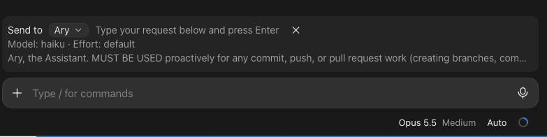

# agent-chat

A Claude Code mod that starts a new Claude Desktop session whose **main agent** is one of your custom agents (from `.claude/agents/` or `~/.claude/agents/`), with its own model, effort, system prompt and skills.

The desktop app can't start a session whose main agent is a custom agent. This mod adds an agent picker and a `/agent-chat` command that do it in one step.

## Install

In a Claude Code session:

```
/plugin install agent-chat --marketplace <owner>/claude-agent-chat
```

Answer `y` to add the marketplace, then choose a scope (`user` makes it available in every session).

## Use

### Agent picker

The Claude Code desktop app has no built-in option to:

- open a new session with a custom agent, such as one defined in `.claude/agents/`
- talk to a custom agent in an existing session

The agent picker fills that gap: pick an agent above the message box and your request goes straight to it.

> **Note:** The picker only lists custom agents that already exist. Set up an agent first, as an agent file in `.claude/agents/` (project) or `~/.claude/agents/` (user). See [Create custom subagents](https://code.claude.com/docs/en/sub-agents) in the Claude Code docs.



*The picker above the message box, showing the agent's model, effort and description.*

1. Type `/agent-chat` with no arguments. A small section appears above the message box:

   ```
   Send to [Finn ▾]  Type your request below and press Enter  ✕
   Model: fable · Effort: high
   Finn, the Lead Engineer. Use for very difficult…
   ```

2. Pick an agent, type your request in the normal message box and press Enter.
3. The message goes to a new session with that agent, not to the current one. The section closes, and the session opens in the desktop app after the agent's first reply.

Click **✕** to close the section without sending anything. While it is open, slash commands still run in the current session.

The desktop app shows a "Prompt dropped by a hook" notice when the message is sent. That's expected: it's how the mod stops the message from also reaching the current session, and the app always shows that notice.

### Command

```
/agent-chat finn Design the caching layer for the search API
/agent-chat --mode plan finn Review the auth flow and propose a refactor
```

`--mode` sets the permission mode for the agent's **first turn** only: `auto` (default), `plan`, `acceptEdits`, `default` or `bypassPermissions`. You can change the mode in the desktop app once the session is open.

## How it works

1. Lists agent files in `<project>/.claude/agents/` and `~/.claude/agents/`, reading `name`, `model`, `effort` and `description` from each file's frontmatter. A project agent wins over a user agent with the same name.
2. Runs the request as a headless first turn, detached from the current session:
   `claude -p --agent <agent> --session-id <uuid> --permission-mode <mode> -n "<Agent>: <request>"`
3. When that turn ends, opens the session in the desktop app with `claude --resume <uuid> --desktop`.

The session keeps the agent: its transcript records `agentSetting: <agent>`, so later turns in the desktop app keep the agent's model and system prompt.

## Limits

- **You can't watch the first turn.** The session appears in the desktop app only after the agent's first reply, which can take minutes for a large request.
- **Nobody can approve tools during the first turn**, so it runs in `auto` mode by default (an automatic safety check per action). The picker always uses `auto`; use the command with `--mode plan` for a read-only first turn.
- Picker messages are text only; images and files are refused.
- macOS only for now: it uses `/usr/bin/uuidgen` and `script`.
- Needs the `claude` CLI on `PATH` (it also looks in `~/.local/bin`, `/opt/homebrew/bin` and `/usr/local/bin`).

> **Tip:** Make the first request a simple one, such as "Hi, what can you do?", just to start the new session. Once it appears in the desktop app, open it and do the real work there.

## Troubleshooting

Each launch writes a log to `~/.claude/agent-chat/<session-id>.log`. If no session appears in the desktop app, check that log; `/agent-chat <agent> <request>` prints its path.

## License

MIT
